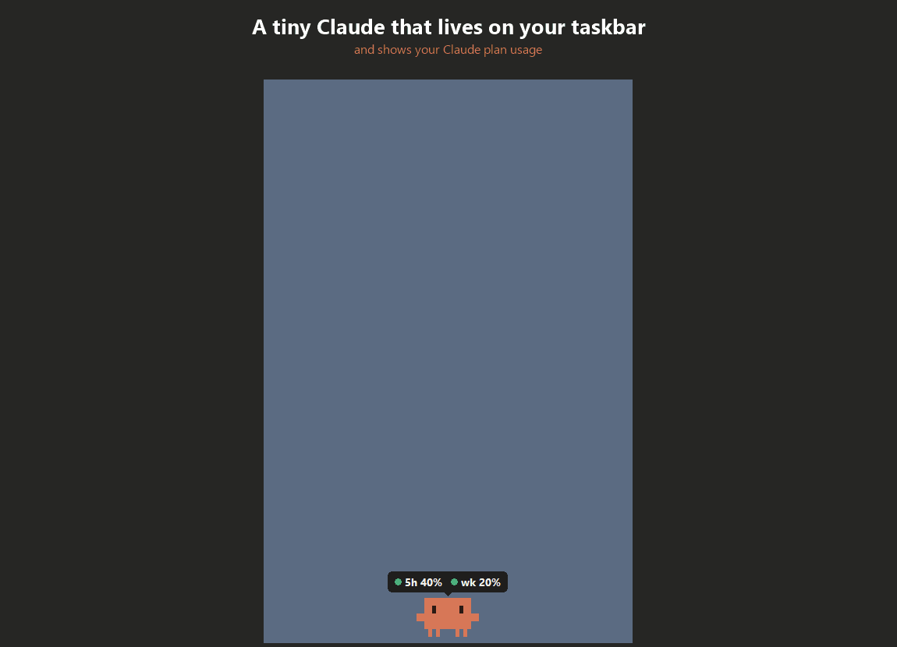
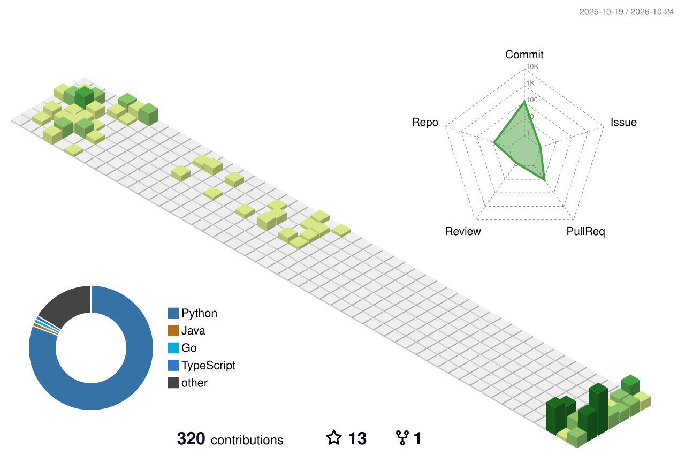

<h1 align="center">have you tried restarting?</h1>

Your 5-hour limit has a personality now.

  
  
  
  
  

  
  
  
  

  

<h3 align="center"><a href="https://github.com/have-you-tried-restarting/claude-usage-pet">Claude usage pet</a></h3>

A pixel mascot on your Windows taskbar that shows your Claude plan usage 
and acts out what Claude Code is doing. No dependencies.

  
  

  <picture>
    <source media="(prefers-color-scheme: dark)" srcset="profile-3d-contrib/profile-night-rainbow.svg">
    
  </picture>

